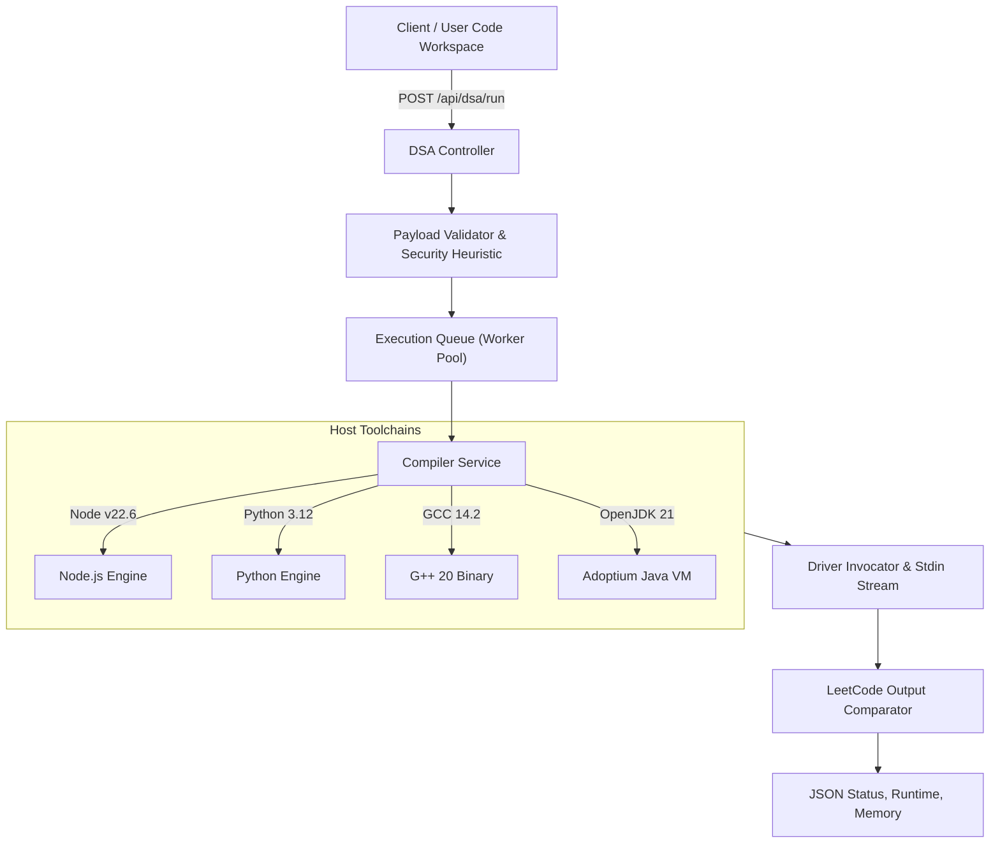

# TechPrep AI — Multi-Language Compiler Architecture

## Safety Measures
1. **Process Timeouts**: Each child process is terminated with `SIGKILL` / `taskkill /F /T` after 6000 ms.
2. **Memory Ceiling**: 512 MB OS limit enforced per process.
3. **Workspace Isolation**: Each run executes in isolated random subfolders within `temp/executions/`.
